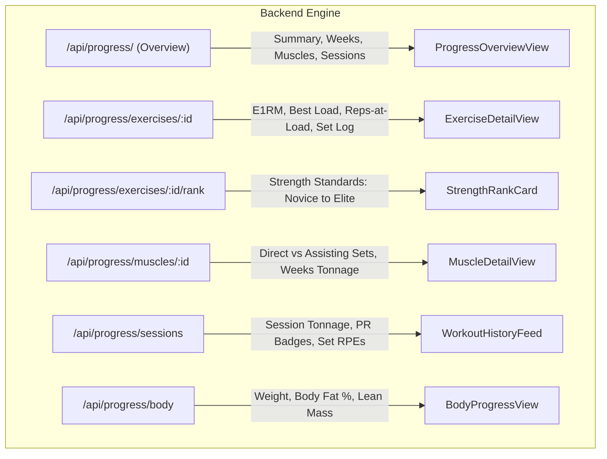

# FitAI Gym Progress Redesign — Master Implementation Plan

> **Deliverable Type**: In-Depth Technical Specification & Implementation Plan  
> **Target Directory**: [`mobile/lib/features/progress`](file:///c:/Users/vklvl/projects/FitAI/mobile/lib/features/progress)  
> **Backend Reference**: [`backend/modules/progress`](file:///c:/Users/vklvl/projects/FitAI/backend/modules/progress) & [`backend/modules/history`](file:///c:/Users/vklvl/projects/FitAI/backend/modules/history)  
> **UI Aesthetic Benchmark**: [`mobile/lib/features/today/components/today_dashboard.dart`](file:///c:/Users/vklvl/projects/FitAI/mobile/lib/features/today/components/today_dashboard.dart) (`_TodaySurface` & `SessionOverviewCard`)  
> **Code Modification Constraint**: **STRICTLY ZERO CODE CHANGES** in this planning phase.

---

## 1. Executive Summary & Problem Diagnosis

### A. The Visual Harmony Disconnect
In the current mobile codebase, the **Today** tab ([`today_dashboard.dart`](file:///c:/Users/vklvl/projects/FitAI/mobile/lib/features/today/components/today_dashboard.dart)) and the **Progress** tab have drifted into two different visual paradigms:

| Visual Element | Today Tab Standard (`_TodaySurface`) | Current Progress Tab Discrepancy | The Required Fix |
| :--- | :--- | :--- | :--- |
| **Card Surface Color** | Pure `DSColors.bgCard` (`#202020`) on `#000000` OLED canvas | Mixed gradients, semi-translucent fills, and `accentTint` washes | **100% Solid `DSColors.bgCard`** (`0xFF202020`) |
| **Drop Shadows** | **NONE** (Zero drop shadow; razor-sharp OLED cutouts) | `FastGlassCard` applies `BoxShadow(color: 0x57000000, blurRadius: 18, offset: (0, 7))` creating a blurry dark halo | **Remove drop shadows entirely** on standard cards; rely on clean hairline borders |
| **Border & Stroke** | `Border.all(color: DSColors.border, width: 0.7)` (`0x1CFFFFFF`); `borderHi` (`0x2AFFFFFF`) on hero cards | Varied border widths and gradient borders (`Color(0x12FFFFFF)`, `specularBorder`) | **Strict 0.7px hairline** using `DSColors.border` (subtle) & `DSColors.borderHi` (hero) |
| **Corner Radius** | Strictly **`18px`** (`BorderRadius.circular(18)`) across all primary cards | Varied radii (`20px`, `22px`, `24px`, `28px`) | Standardize to **`18px`** for cards, **`12px`** for inner metric chips, **`100px`** for pills |
| **Inner Metric Chips** | `Color(0xFF292929)` or `DSColors.bgRaised` (`0xFF2A2A2A`) with `radius: 12` | Ad-hoc containers with inline paddings | Standardize inner chips to **`DSColors.bgRaised`** with `12px` radius |
| **Controls & Inputs** | Titanium pills, custom motion toggles | Standard Material `DropdownButton` inside `ExerciseProgressContent` and `ProgressSectionControl` | Replace all dropdowns with **Obsidian capsule segment pickers** |

### B. The Lifter Domain Discrepancy ("How Real Gym Apps Show Progress")
Serious gym lifters and bodybuilders (who use apps like **Hevy**, **Strong**, **RP Hypertrophy**, and **MacroFactor**) do not evaluate progress by a generic workout count. They evaluate progress through:
1. **Progressive Overload & Strength Progression**: Estimated 1-Rep Max (E1RM) trajectory, heaviest working weight progression, and rep PRs at working load.
2. **Weekly Volume Load (Tonnage)**: $\sum (\text{weight} \times \text{reps})$ across each week and per muscle group (measuring total hypertrophy stimulus).
3. **Strength Classification & Standards**: "Where do I stand relative to my bodyweight?" (e.g., Novice vs Intermediate vs Advanced Bencher).
4. **Personal Record (PR) Vault**: Distinct badges and showcases for Weight PRs, Rep PRs, and Volume PRs.
5. **Logged Set History with RPE**: An ultra-clean, readable set-by-set logbook (`Set 1: 100 kg × 8 @ RPE 8`) so lifters know what to load on the bar today.
6. **Bodyweight vs Strength Correlation**: Tracking if strength is maintained during cuts or accelerated during bulks.

**The Golden Opportunity**: FitAI's backend **already computes and serves almost all of this data** (`estimatedStrength` via Epley formula, `strengthRank` with real bodyweight standards, `volume` tonnage, `records.repsAtLoad`, and set-by-set RPE logs), but the mobile UI currently under-utilizes or hides these capabilities!

---

## 2. Backend Capabilities & Endpoint Integration Map

Our audit of `backend/modules/progress` and `backend/modules/history` reveals a rich athletic data schema:



### Specific Data Mapping:
1. **Weekly Volume Tonnage**:
   - Backend: `weeks[i].volume` (calculated via `setVolume(set) = weight * reps`).
   - UI Use: Hero scoreboard headline and weekly volume rhythm bars.
2. **Estimated 1-Rep Max (E1RM)**:
   - Backend: `exerciseSeries.estimatedStrength = Math.round(weight * (1 + reps/30) * 10) / 10`.
   - UI Use: Primary progression curve in exercise detail view.
3. **Strength Standards Classification**:
   - Backend: `getExerciseRank` / `strength_rank.ts` matches user age, sex, and bodyweight to `strength_standards.json` returning `Beginner`, `Novice`, `Intermediate`, `Advanced`, or `Elite`.
   - UI Use: Dedicated strength rank badge and target milestone progress bar.
4. **Personal Record (PR) Events**:
   - Backend: `records.repsAtLoad` (best reps at each weight) and `recordEvents` (`load`, `reps_at_load`, `set_volume`).
   - UI Use: Golden Rosette PR chips on workout cards and PR Vault in exercise details.
5. **Set-by-Set RPE Logbook**:
   - Backend: `history[i].entries = [{ setNumber, weight, reps, rpe }]`.
   - UI Use: High-contrast tabular set log matching Hevy/Strong.

---

## 3. Design System Harmony Specification (Matching `TodayHomeView`)

To achieve seamless visual harmony between the Today dashboard and the Progress tab, every progress screen will adhere to this design specification:

```dart
// ── Shared Surface Architecture ─────────────────────────────────────────────
class ProgressCardSurface extends StatelessWidget {
  final Widget child;
  final VoidCallback? onTap;
  final EdgeInsetsGeometry padding;
  final bool hero;
  
  const ProgressCardSurface({
    super.key,
    required this.child,
    this.onTap,
    this.padding = const EdgeInsets.all(16),
    this.hero = false,
  });

  @override
  Widget build(BuildContext context) {
    return MotionPress(
      enabled: onTap != null,
      child: Material(
        color: DSColors.bgCard, // 0xFF202020
        borderRadius: BorderRadius.circular(18), // Today Tab 18px Standard
        clipBehavior: Clip.antiAlias,
        child: DecoratedBox(
          decoration: BoxDecoration(
            borderRadius: BorderRadius.circular(18),
            color: DSColors.bgCard,
            border: Border.all(
              color: hero ? DSColors.borderHi : DSColors.border, // 0x2AFFFFFF vs 0x1CFFFFFF
              width: 0.7,
            ),
          ),
          child: InkWell(
            onTap: onTap,
            child: Padding(padding: padding, child: child),
          ),
        ),
      ),
    );
  }
}
```

### Color & Token Hierarchy:
- **Canvas Background**: `DSColors.bg` (`0xFF000000`) — Pure OLED black.
- **Card Background**: `DSColors.bgCard` (`0xFF202020`) — Solid obsidian, no drop shadow.
- **Nested Card / Inner Chip**: `DSColors.bgRaised` (`0xFF2A2A2A`) — For stat boxes and set chips.
- **Hairline Borders**: `DSColors.border` (`0x1CFFFFFF`, width: `0.7`) and `DSColors.borderHi` (`0x2AFFFFFF`, width: `0.7`).
- **Typography**:
  - Primary Text: `DSColors.silver` (`0xFFE2E2E2`) or `Colors.white`.
  - Secondary Text: `DSColors.muted` (`0xFF969696`).
  - Numbers: Tabular figures enabled (`FontFeature.tabularFigures()`), letter spacing `-0.5` to `-0.8`.
- **Athletic Accent Accents (Whoop 4.0 Biometric Tokens)**:
  - Strength & Load: `DSColors.ice` (`0xFF5AC8FA`) or `DSColors.whoopStrainCyan` (`0xFF00E5FF`).
  - Personal Records (PRs): `DSColors.gold` (`0xFFFFB84D`).
  - Hypertrophy & Muscle: `DSColors.pulse` (`0xFF8B7BFF`) or `DSColors.whoopSleepPurple` (`0xFF7C4DFF`).
  - Consistency & Completed Workouts: `DSColors.accent` / `whoopRecoveryGreen` (`0xFF00E676`).

---

## 4. Screen-by-Screen Redesign Blueprint

### Screen 1: Main Progress Hub ([`progress_overview_view.dart`](file:///c:/Users/vklvl/projects/FitAI/mobile/lib/features/progress/views/progress_overview_view.dart))

#### 1. Fixed Header & Filter Bar:
- Aligns with Today's fixed header padding (`EdgeInsets.fromLTRB(16, 16, 16, 12)`).
- Left: Screen Title (`Progress`) with dynamic uppercase period tag (`"LAST 4 WEEKS · 2 OCT – 30 OCT"`).
- Right: Capsule filter pill (`[ 4W ▾ ]`) opening the dark Obsidian bottom sheet.

#### 2. Hero Work Capacity & Tonnage Scoreboard ([`progress_training_hero.dart`](file:///c:/Users/vklvl/projects/FitAI/mobile/lib/features/progress/components/progress_training_hero.dart)):
- **Primary Hero Metric**: Total Volume Load / Tonnage (e.g., `48,250 kg` or `106.4k lbs`) with tabular figures at `44pt` font.
  - Subtitle: `Total Volume Load` with a `+12.4%` delta chip.
- **Athletic Stat Row** (3 discrete inner chips on `DSColors.bgRaised` with `12px` radius):
  - Chip 1 (Cyan): **Total Sets** (e.g., `184 Sets`).
  - Chip 2 (Green): **Workouts** (e.g., `16 Sessions`).
  - Chip 3 (Gold): **PRs Hit** (e.g., `8 Records 🏆`).
- **Weekly Volume Rhythm Bars**:
  - 4 to 12 vertical bars showing weekly tonnage distribution.
  - Active week highlighted with subtle neon cyan stroke.

#### 3. Section Switcher ([`progress_dashboard.dart`](file:///c:/Users/vklvl/projects/FitAI/mobile/lib/features/progress/components/progress_dashboard.dart)):
- Replaces custom dark background with a clean 3-segment pill control: `[ Overview | Exercises | History ]`.
- Sliding active indicator with `HapticFeedback.selectionClick()`.

#### 4. Pinned & Trending Exercises Shelf:
- Horizontal scrolling cards (`width: 170`, `height: 168`) on `DSColors.bgCard` with `18px` radius.
- Exercise name, last performed date, current working weight (e.g. `100 kg × 5`), load delta chip (`+5.0%`), and mini sparkline.

#### 5. Muscle Hypertrophy Distribution Snapshot:
- Compact card showing top trained muscle groups.
- Direct sets vs Assisting sets progress bars with Whoop-style gradient fills.

#### 6. Recent Workouts Timeline ([`progress_workout_history.dart`](file:///c:/Users/vklvl/projects/FitAI/mobile/lib/features/progress/components/progress_workout_history.dart)):
- Renders completed session cards mirroring `SessionOverviewCard` in Today.
- Displays: Session Name, Date, Duration, Sets, **Volume Load Tonnage** (`14,800 kg`), and Gold Rosette PR badges.

---

### Screen 2: Exercise Progress & PR Vault ([`exercise_progress_content.dart`](file:///c:/Users/vklvl/projects/FitAI/mobile/lib/features/progress/components/exercise_progress_content.dart) & [`progress_detail_view.dart`](file:///c:/Users/vklvl/projects/FitAI/mobile/lib/features/progress/views/progress_detail_view.dart))

#### 1. Strength Standards Classification Card:
- Powered by `data['rank']['strengthRank']` and `getExerciseRank`.
- Shows lifter classification: **`Intermediate Lifter`** (e.g., "1.25× bodyweight reference").
- Milestone Progress Bar: Progress toward next tier ("Advanced Lifter at 115 kg • 82%").
- Badges: `First Log`, `5 Training Days`, `Personal Best`.

#### 2. Interactive Progression Chart:
- **Metric Selector**: Replaces dropdown with horizontal capsule tabs:
  `[ Weight | Est. 1RM | Volume | Reps ]`.
- Smooth interactive Bézier curve with dot markers for each workout session.
- Tooltip on touch showing: Date, Metric Value, and Best Set.

#### 3. Personal Record (PR) Vault:
- A dedicated 2-column or 3-column gold-tinted showcase card:
  - **Heaviest Weight**: `105.0 kg × 3` (Date: 24 Oct)
  - **Peak Est. 1RM**: `114.2 kg` (Date: 24 Oct)
  - **Highest Set Volume**: `1,000 kg` (100 kg × 10 reps)
- **Rep Maxes Breakdown**:
  - Horizontal scroll of best reps at load from `records.repsAtLoad` (e.g., `100kg: 5 reps`, `90kg: 8 reps`, `80kg: 12 reps`).

#### 4. The Lifter's Set Logbook Table (Hevy Style):
- Grouped by workout session dates in reverse chronological order.
- Clean high-contrast table:
  ```
  Date: Monday, 28 Oct 2026 · Push Day A
  ┌──────┬────────────┬─────────┬──────────┬──────────┐
  │ Set  │ Previous   │ Weight  │ Reps     │ RPE      │
  ├──────┼────────────┼─────────┼──────────┼──────────┤
  │  1   │ 80 kg × 10 │ 85 kg   │ 10 reps  │ @ 7.5    │
  │  2   │ 90 kg × 8  │ 95 kg   │ 8 reps   │ @ 8.5    │
  │  3   │ 100 kg × 4 │ 102.5 kg│ 5 reps 🔥│ @ 9.5 PR │
  └──────┴────────────┴─────────┴──────────┴──────────┘
  ```

---

### Screen 3: Muscle Hypertrophy Volume ([`muscle_progress_content.dart`](file:///c:/Users/vklvl/projects/FitAI/mobile/lib/features/progress/components/muscle_progress_content.dart))

#### 1. Hypertrophy Volume Landmark Scoreboard:
- Shows total direct sets vs assisting sets for the selected muscle group (e.g. Chest: `16 Direct Sets / week`).
- Hypertrophy Target Indicator (based on RP science):
  - `< 6 sets`: Maintenance Volume (MV)
  - `10 - 20 sets`: Minimum Adaptive / Maximum Adaptive Volume (MEV / MAV) — Optimal Growth
  - `> 22 sets`: Maximum Recoverable Volume (MRV) caution zone.

#### 2. Weekly Sets Trend Chart:
- Multi-week bar chart displaying weekly set volume progression.

#### 3. Contributing Exercises List:
- Exercises that contributed to this muscle's volume, ordered by total sets logged.
- Tap takes the lifter directly to the Exercise Progress view.

---

### Screen 4: Workout History Feed ([`progress_workout_history.dart`](file:///c:/Users/vklvl/projects/FitAI/mobile/lib/features/progress/components/progress_workout_history.dart))

#### 1. Workout Session Cards:
- Built with `ProgressCardSurface` (`DSColors.bgCard`, `radius: 18`, `border: 0.7px DSColors.border`).
- **Header**: Calendar date pill + Session Name + Status chip (`Completed`).
- **Athletic Stats Row**:
  - 🏋️ **Volume Tonnage**: e.g., `16,420 kg`
  - 🔢 **Sets**: `22 sets`
  - ⏱️ **Duration**: `58 min`
  - 🏆 **PR Count**: Gold rosette badge (`2 New PRs`)
- **Exercise Summary Chips**:
  - Compact horizontal tags of exercises completed (`Incline Dumbbell Press`, `Barbell Bench`, `Cable Flyes`).
- Tap opens full Session Recap Modal.

---

### Screen 5: Body Composition & Strength Correlation ([`body_progress_content.dart`](file:///c:/Users/vklvl/projects/FitAI/mobile/lib/features/progress/components/body_progress_content.dart))

#### 1. Body Composition Metrics:
- Replaces raw list tiles with `ProgressCardSurface` tiles for Weight, Body Fat %, and Lean Mass.
- Trend indicator showing rate of change per week (e.g. `-0.3 kg/week` for cutting or `+0.2 kg/week` for lean bulking).

#### 2. Bodyweight vs Strength Performance Note:
- Visual correlation highlighting strength retention or gain during bodyweight fluctuations.

---

## 5. Technical Architecture & File Inventory

The implementation touches only presentation files in `mobile/lib/features/progress`:

```
mobile/lib/features/progress/
├── components/
│   ├── progress_surface.dart          # Update: standardize to 18px radius, DSColors.bgCard, no drop shadows
│   ├── progress_training_hero.dart     # Update: Volume Load Tonnage headline, athletic stat chips, rhythm bars
│   ├── progress_dashboard.dart         # Update: 3-segment pill control, clean exercise trends shelf
│   ├── progress_workout_history.dart   # Update: Session cards with tonnage, sets, duration, and PR badges
│   ├── exercise_progress_content.dart  # Update: Strength Rank badge, capsule metric tabs, PR Vault, set logbook
│   ├── muscle_progress_content.dart    # Update: Direct vs assisting hypertrophy volume landmarks
│   ├── body_progress_content.dart      # Update: 18px cards, lean mass tracking, replace standard ListTiles
│   └── progress_date_filter.dart       # Verified: Titanium capsule pill and bottom sheet modal
└── views/
    ├── progress_overview_view.dart     # Update: Layout grid, stats row, pinned exercises, recent sessions
    ├── progress_detail_view.dart       # Update: Clean app bar, wire strength rank and exercise subviews
    └── progress_exercises_view.dart    # Update: Obsidian search bar, muscle filter chips, exercise list rows
```

---

## 6. Execution Roadmap & Verification Checklist

### Phase 1: Surface & Card Foundation
- [ ] Audit and refactor `ProgressSurface` to use exact `DSColors.bgCard` (`#202020`), `BorderRadius.circular(18)`, and `0.7px` hairline border.
- [ ] Eliminate blurry drop shadows (`boxShadow`) from cards on the black OLED canvas.
- [ ] Standardize inner chips to `DSColors.bgRaised` with `12px` corner radius.

### Phase 2: Lifter Scoreboard & Overview
- [ ] Elevate Volume Load Tonnage (`weeks.volume`) as the headline metric on `ProgressTrainingHero`.
- [ ] Implement the 3 athletic metric chips (Sets, Workouts, PRs).
- [ ] Refactor `ProgressSectionControl` to use the design system pill gradient with haptic feedback.
- [ ] Update recent session cards in `ProgressWorkoutHistory` to feature volume tonnage and PR rosettes.

### Phase 3: Exercise Progress & PR Vault
- [ ] Integrate `data['rank']['strengthRank']` to display the lifter's classification badge (Novice to Elite).
- [ ] Replace `DropdownButton` with horizontal capsule selector pills (`[ Weight | Est. 1RM | Volume | Reps ]`).
- [ ] Build the Personal Record (PR) Vault showcasing Heaviest Load, Best 1RM, and Rep Maxes at Load.
- [ ] Polish the Set Logbook table with tabular figures and RPE badges.

### Phase 4: Muscle Hypertrophy & Body Views
- [ ] Upgrade `MuscleDistributionContent` with hypertrophy landmark badges (Maintenance vs Adaptive volume).
- [ ] Clean up `BodyProgressContent` removing generic Material `ListTile` in favor of `ProgressCardSurface`.

### Phase 5: Verification & QA
- [ ] Run `flutter analyze` ensuring zero warnings or compile errors.
- [ ] Verify side-by-side visual parity between `TodayDashboard` and `ProgressOverviewView`.
- [ ] Verify dark mode OLED contrast across all charts, pills, and set tables.

