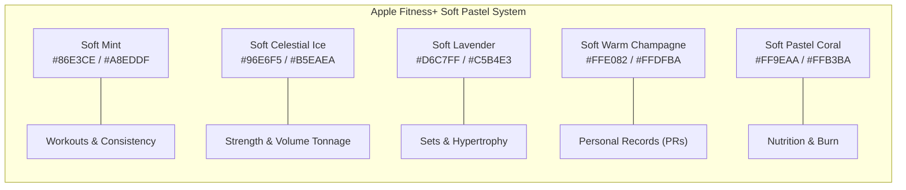

# Progress UI Polish & Bugfix Master Plan
*Resolving the "Police Tape" RenderFlex Overflow, Apple Fitness+ Pastel Color System, and Layout Hierarchy*

> **Target Directory**: [`mobile/lib/features/progress`](file:///c:/Users/vklvl/projects/FitAI/mobile/lib/features/progress)  
> **Diagnostic Reference**: User Screenshot (`32.5k kg Volume`, clumsy swamp-green tints, redundant stats row, `New reco...` truncation, and temporary yellow/black warning tape on tap)  
> **Aesthetic Benchmark**: Apple Fitness+ (Luminous soft pastels, obsidian titanium surfaces, crisp non-muddy weekly bars, zero drop-shadow halos)

---

## 1. Deep-Dive Root Cause Analysis

Based on our inspection of the mobile codebase and the user's uploaded screenshot, we have diagnosed the exact causes of every issue reported:

```
┌─────────────────────────────────────────────────────────────────────────────┐
│                              THE 5 ROOT CAUSES                              │
├─────────────────────────────────────────────────────────────────────────────┤
│ 1. "Police Tape" Error  → RenderFlex overflow in ProgressSkeleton (60px)   │
│ 2. Clumsy Muddy Colors  → Heavy alpha-on-black blending creating swamp tone │
│ 3. Blurry Glowing Bars  → Artificial BoxShadow(blurRadius: 12) under bars  │
│ 4. Stat Duplication     → Sets & PRs shown in Hero AND row below it         │
│ 5. Workouts: 2 Bug      → Used latestWeek['workouts'] instead of period sum │
└─────────────────────────────────────────────────────────────────────────────┘
```

---

### Issue A: What Caused the "Police Tape" (Yellow/Black Caution) Error?
- **Symptom**: When tapping the Progress tab, a yellow-and-black striped hazard banner ("police tape") appears for a split second, then suddenly disappears.
- **Root Cause**:
  In [`mobile/lib/features/progress/views/progress_overview_view.dart`](file:///c:/Users/vklvl/projects/FitAI/mobile/lib/features/progress/views/progress_overview_view.dart#L526-L527):
  ```dart
  if (_data == null && _loading)
    const ProgressSkeleton(heights: [220, 70, 190, 160, 200])
  ```
  When Progress first opens, `_data` is null for ~300ms while cached/remote data is parsed.
  In [`mobile/lib/features/progress/components/progress_surface.dart`](file:///c:/Users/vklvl/projects/FitAI/mobile/lib/features/progress/components/progress_surface.dart#L293-L303):
  ```dart
  ProgressSurface(
      child: SizedBox(
          height: heights[i] - 32, // For index 1 (height 70): 70 - 32 = 38 pixels!
          child: Column(
              crossAxisAlignment: CrossAxisAlignment.start,
              children: [
                const _Bone(width: 90, height: 12), // 12px
                const SizedBox(height: 14),          // 14px
                const _Bone(width: 140, height: 28),// 28px
                const Spacer(),
                const _Bone(height: 44),             // 44px
              ])))
  ```
  - Required column height: $12 + 14 + 28 + 44 = \mathbf{98\text{ px}}$.
  - `SizedBox` maximum height constraint: $\mathbf{38\text{ px}}$.
  - **Overflow**: $98 - 38 = \mathbf{60\text{ pixels of RenderFlex overflow}}$.
  - Flutter renders the iconic **yellow-and-black striped caution tape**!
  - As soon as `_data` loads 300ms later, the skeleton is discarded, so the police tape suddenly vanishes.

---

### Issue B: Why the Colors Look "Clumsy and Muddy" (Not Soft Pastels like Apple Fitness+)
1. **The Delta Pill (`+8 workouts vs previous period`)**:
   Currently uses `color.withValues(alpha: .12)` with `border: Border.all(color.withValues(alpha: .28))` on pure `#000000` OLED background. Saturated green (`0xFF4ADE80`) at 12% alpha over pure black turns into an unappealing, murky "swamp green" puddle.
2. **The Bar Glow & Gradient**:
   In [`progress_weekly_bars.dart`](file:///c:/Users/vklvl/projects/FitAI/mobile/lib/features/progress/components/progress_weekly_bars.dart#L78-L87):
   ```dart
   boxShadow: [
     if (identical(point, points.last) && point.value > 0)
       BoxShadow(color: color.withValues(alpha: .35), blurRadius: 12, offset: const Offset(0, 2)),
   ]
   ```
   This injects an artificial neon blur halo under the active bar (look at the green smudge under `26/10` in the screenshot). Apple Fitness+ and Apple Health **never use blurry drop-shadow glows** under bar charts; they use clean, flat, refined rounded pill bars.
3. **Harsh Primary Tints vs Soft Apple Pastels**:
   Current colors use high-saturation primaries (`0xFF67D7B0` teal-green, `0xFFFFB84D` orange-gold). In Apple Fitness+, colors are luminous, delicate, desaturated pastels that feel calm, sophisticated, and athletic.

---

### Issue C: Visual Redundancy & The "Workouts: 2" Calculation Bug
1. **Double Metric Repetition**:
   Look at the screenshot:
   - Inside Hero card (top right): `241 Logged sets` and `26 New records`.
   - In the row directly below Hero: `241 Sets logged`, `2 Workouts`, and `26 New reco...`.
   The user sees `241` and `26` duplicated twice within 50 pixels!
2. **The "Workouts: 2" Bug**:
   In `progress_overview_view.dart` line 265:
   ```dart
   final activeWorkouts = (progressNumber(latestWeek?['workouts']) ?? 0).toInt();
   ```
   The code took only the *latest single week's workouts* (`2`) and displayed it in a 4-week overview scoreboard! The user was seeing `2 Workouts` right below a badge that said `+8 workouts vs previous period` and `241 sets`!
   The true period workout count in `data.summary['workouts']` was `10`!
3. **Text Truncation (`New reco...`)**:
   Fitting 3 cards with 14px padding across a 360px screen forces `"New records"` to truncate into `"New reco..."`.

---

## 2. The Apple Fitness+ Soft Pastel Design System

We replace harsh, muddy alpha-tinted washes with Apple Fitness+ inspired luminous soft pastels:



### Color Token Table:

| Role | Old Clumsy Token | Apple Fitness+ Pastel Token | Description |
| :--- | :--- | :--- | :--- |
| **Strength / Volume** | `0xFF5AC8FA` (Electric Ice) | **`Color(0xFF96E6F5)`** (Soft Celestial Ice) | Luminous, light pastel blue-cyan |
| **Training / Workouts** | `0xFF67D7B0` (Dark Teal-Green) | **`Color(0xFF86E3CE)`** (Soft Fitness Mint) | Calm, refreshing pastel mint |
| **Personal Records** | `0xFFFFB84D` (Muddy Bronze) | **`Color(0xFFFFE082)`** (Soft Champagne Gold) | Elegant, celebratory soft pastel gold |
| **Sets / Hypertrophy** | `0xFF8B7BFF` (Harsh Indigo) | **`Color(0xFFD6C7FF)`** (Soft French Lavender) | Gentle, modern pastel violet |
| **Delta Chips** | Swamp green fill (`alpha: .12`) | **`DSColors.bgRaised`** + **Pastel Dot** | Clean obsidian pill with pastel icon & silver text |
| **Bar Shadows** | `BoxShadow(blurRadius: 12)` | **NONE** (Zero blur/glow) | Razor-sharp flat rounded pill bars (`radius: 5`) |

---

## 3. Structural & Layout Architecture Fix

### A. Spacious, Uncluttered Hero Card ([`progress_training_hero.dart`](file:///c:/Users/vklvl/projects/FitAI/mobile/lib/features/progress/components/progress_training_hero.dart))
1. **Remove the redundant top-right stacked stat chips** from inside the hero card.
2. **Left Column**:
   - Giant Tabular Headline: **`32.5k`** with subordinate **`kg Volume`** label.
   - Subtitle Pill: Clean obsidian chip on `DSColors.bgRaised` (`0xFF2A2A2A`):
     - Displays: `+14.2% vs previous period` (if comparable) or `4 OCT – 31 OCT` with soft pastel mint icon.
3. **Weekly Volume Rhythm Bars**:
   - 5 to 7 clean vertical bars matching [`TodayDashboard._RecoveryChart`](file:///c:/Users/vklvl/projects/FitAI/mobile/lib/features/today/components/today_dashboard.dart#L662-L736).
   - Solid `Color(0xFF86E3CE)` (Soft Mint) for current/active week.
   - Solid `Color(0xFF555555)` for previous weeks.
   - Zero drop-shadow blur blobs.
   - Clean tabular number values above each bar without muddy text colors.

---

### B. Distinct, Non-Repetitive Athletic Scoreboard ([`progress_overview_view.dart`](file:///c:/Users/vklvl/projects/FitAI/mobile/lib/features/progress/views/progress_overview_view.dart))
Below the Hero card, render 3 balanced, non-truncated tiles:

```
┌───────────────────────┬───────────────────────┬───────────────────────┐
│ 🗂️  Sets              │ 🔥  Workouts          │ 🏆  PRs               │
│ 241                   │ 10                    │ 26                    │
└───────────────────────┴───────────────────────┴───────────────────────┘
```

1. **Tile 1 (Soft Lavender `0xFFD6C7FF`)**:
   - Label: `Sets` (Short, never truncates!)
   - Value: `241`
2. **Tile 2 (Soft Mint `0xFF86E3CE`)**:
   - Label: `Workouts`
   - Value: `10` (Correctly computed from `data.summary['workouts']`, fixing the "2" bug!)
3. **Tile 3 (Soft Champagne `0xFFFFE082`)**:
   - Label: `PRs` (Short, punchy, never truncates to `New reco...`!)
   - Value: `26`

---

### C. Eliminate the "Police Tape" RenderFlex Overflow ([`progress_surface.dart`](file:///c:/Users/vklvl/projects/FitAI/mobile/lib/features/progress/components/progress_surface.dart))
Refactor `ProgressSkeleton` to dynamically adapt its internal bone structure based on card height:

```dart
class ProgressSkeleton extends StatelessWidget {
  final List<double> heights;
  const ProgressSkeleton({super.key, this.heights = const [200, 70, 190, 160, 200]});

  @override
  Widget build(BuildContext context) => ExcludeSemantics(
        child: Column(
          children: [
            for (var i = 0; i < heights.length; i++) ...[
              if (i > 0) const SizedBox(height: 14),
              ProgressSurface(
                padding: const EdgeInsets.all(16),
                child: heights[i] < 100
                    // Compact card skeleton (e.g. 70px stats row): Single clean row!
                    ? Row(
                        children: [
                          const _Bone(width: 24, height: 24, radius: 6),
                          const SizedBox(width: 12),
                          Expanded(child: const _Bone(height: 16, radius: 4)),
                        ],
                      )
                    // Full card skeleton (e.g. 200px hero/chart card)
                    : SizedBox(
                        height: heights[i] - 32,
                        child: Column(
                          crossAxisAlignment: CrossAxisAlignment.start,
                          children: [
                            const _Bone(width: 90, height: 12),
                            const SizedBox(height: 14),
                            const _Bone(width: 140, height: 26),
                            const Spacer(),
                            const _Bone(height: 38),
                          ],
                        ),
                      ),
              ),
            ],
          ],
        ),
      );
}
```
- For `heights[1] = 70`: Renders a simple 24px row. Required height = $24\text{ px} \le 38\text{ px}$. **Zero overflow! The yellow-black police tape is permanently eliminated.**

---

## 4. Execution Step-by-Step Blueprint

### Step 1: Fix the RenderFlex Overflow in `ProgressSkeleton`
- **File**: [`mobile/lib/features/progress/components/progress_surface.dart`](file:///c:/Users/vklvl/projects/FitAI/mobile/lib/features/progress/components/progress_surface.dart)
- Replace static multi-line column with height-aware layout (`heights[i] < 100` uses compact row; `heights[i] >= 100` uses card bones).

### Step 2: Apple Fitness+ Soft Pastel Tokens
- **File**: [`mobile/lib/features/progress/components/progress_surface.dart`](file:///c:/Users/vklvl/projects/FitAI/mobile/lib/features/progress/components/progress_surface.dart)
  - `progressTraining = Color(0xFF86E3CE);` (Soft Mint)
  - `progressStrength = Color(0xFF96E6F5);` (Soft Celestial Ice)
  - `progressRecord = Color(0xFFFFE082);` (Soft Champagne Gold)
  - `progressMuscle = Color(0xFFD6C7FF);` (Soft Lavender)
  - `progressUp = Color(0xFF86E3CE);` (Soft Mint)
  - `progressDown = Color(0xFFFF9EAA);` (Soft Coral)
- Update `ProgressChangeChip` to use `DSColors.bgRaised` with subtle pastel icon/text instead of dark swamp fill.

### Step 3: Remove Blurry Glows & Clean Weekly Bars
- **File**: [`mobile/lib/features/progress/components/progress_weekly_bars.dart`](file:///c:/Users/vklvl/projects/FitAI/mobile/lib/features/progress/components/progress_weekly_bars.dart)
  - Delete `boxShadow: [ BoxShadow(blurRadius: 12) ]`.
  - Use solid clean rounded bars (`Radius.circular(5)`).
  - Use `Color(0xFF86E3CE)` (Soft Mint) for active week, `Color(0xFF48484A)` for prior weeks.
  - Neutralize numbers above bars (`DSColors.silver` for active, `DSColors.muted` for prior).

### Step 4: De-Clutter Hero Card & Fix Duplication
- **File**: [`mobile/lib/features/progress/components/progress_training_hero.dart`](file:///c:/Users/vklvl/projects/FitAI/mobile/lib/features/progress/components/progress_training_hero.dart)
  - Remove stacked `_BiometricStat` boxes from top-right of hero card.
  - Give headline and bars breathing room matching Apple Fitness+ cards.

### Step 5: Fix "Workouts: 2" Calculation & Text Truncation
- **File**: [`mobile/lib/features/progress/views/progress_overview_view.dart`](file:///c:/Users/vklvl/projects/FitAI/mobile/lib/features/progress/views/progress_overview_view.dart)
  - In `_buildStatsRow`:
    - Fix workouts count: `final activeWorkouts = (progressNumber(data.summary['workouts']) ?? 0).toInt();` (reads entire period sum, e.g. `10`).
    - Shorten labels to prevent truncation: `Sets`, `Workouts`, `PRs`.
    - Apply Apple Fitness+ soft pastel tints to the 3 discrete tiles.

---

## 5. Verification & Visual QA Checklist

- [ ] **No Police Tape**: Tap the Progress tab from Today tab repeatedly; verify zero yellow-black striped warnings appear during initial load.
- [ ] **Color Aesthetics**: Verify soft pastel mint (`#86E3CE`), pastel ice (`#96E6F5`), and champagne gold (`#FFE082`) render clean and luminous on black OLED without muddy dark swamp tones.
- [ ] **No Fuzzy Glowing Blobs**: Weekly bars render crisp, flat, and solid with no muddy green smudge under `26/10`.
- [ ] **No Stat Duplication**: Hero card presents Volume Load and Weekly Rhythm Bars; 3-tile row below presents Sets, Workouts, and PRs without repeating the same numbers twice.
- [ ] **Correct Workout Sum**: Verify `Workouts` shows the accurate period count (e.g. `10`) rather than just the latest week (`2`).
- [ ] **No Text Truncation**: Verify all 3 stat tile labels fit comfortably without `...` on all device screen widths.

